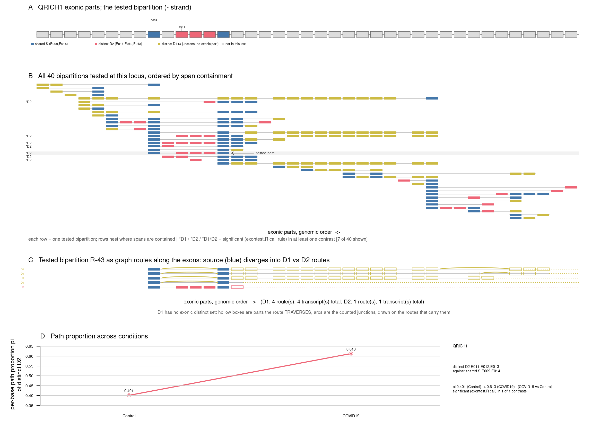
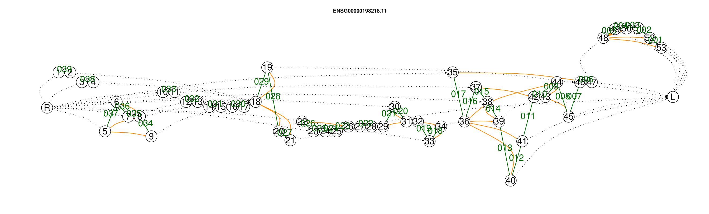
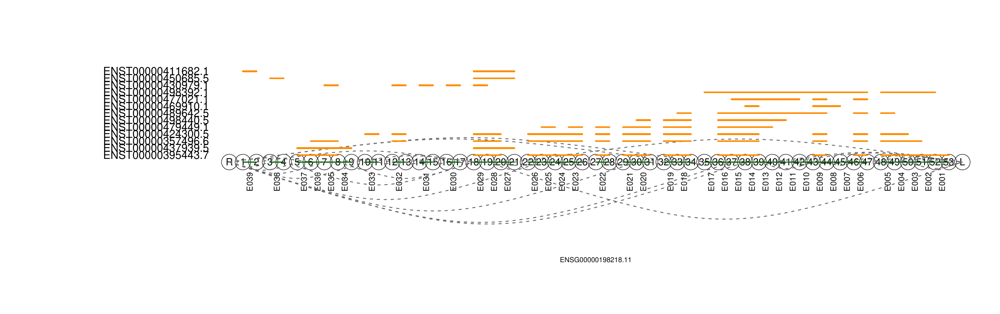

# GrASE
Graph of Alternative Splice junctions and Exonic parts

> **Note:** If you are looking for the source code for the paper [A novel splicing graph allows a direct comparison between exon-based and splice junction-based approaches to alternative splicing detection](https://academic.oup.com/bib/article/26/3/bbaf204/8127326), please check the [`archive/v1-archive` branch](https://github.com/HanLabUNLV/GrASE/tree/archive/v1-archive) or the [`v1.0` tag](https://github.com/HanLabUNLV/GrASE/releases/tag/v1.0).

## About
GrASE (**Gr**aph of **A**lternative **S**plice Junctions and **E**xonic Parts) is a graph-based framework for detecting differential alternative splicing between two conditions from RNA-seq data.

**Core idea.** GrASE represents each gene as a directed acyclic graph (DAG) in which nodes are exonic parts and edges are splice junctions. Within this graph it identifies *bubbles*  -  subgraphs with a shared source and a shared sink  -  each of which corresponds to a region of alternative splicing. This formulation naturally captures events where more than two transcript paths compete inside a single bubble, which simpler binary-focused tools miss.

**What it does that other tools do not.** Instead of classifying splicing into fixed event types (SE, A3SS, etc.), GrASE tests all bubbles it can enumerate in the annotation, examining substantially more events than prior tools while remaining tractable and interpretable. For each bubble it quantifies differential usage as the fraction of reads mapping to the exonic parts that *distinguish* the competing paths (the "distinct" parts) relative to distinct + shared parts.

**Comparison structure.** Each bubble is split by **lower-set bipartition**: the
transcript paths are divided into two groups chosen so that each side has a
well-defined distinct set of exonic parts, analogous to PSI-based tests but
without a fixed event taxonomy. 

**Filtering by event class.** Each graph carries two terminal nodes in transcription order: the root `R`, where transcription starts, and the leaf `L`, where it ends. Bubbles that begin at `R` or end at `L` are classified as terminal events (alternative transcription start or end sites); all others are internal events. Both categories are tested independently.

**Statistical models.** Differential path usage is tested with a beta-binomial model (via glmmTMB), with the per-test overdispersion (phi) regularised by Empirical Bayes shrinkage. Two variants are recommended and differ only in how the moderated phi is obtained: `betabinom_EBapprox` (closed form) and `betabinom_EBmap` (MAP).

**Workflow.** The pipeline goes from per-gene splicing graphs (GraphML) -> bubble enumeration -> event-type filtering -> DEXSeq count aggregation -> optional junction substitution where a distinct set is empty -> statistical testing. The DEXSeq helper scripts for preparing the annotation and counting reads are bundled, so the only external input is aligned BAM files. Results can be compared against rMATS or DEXSeq output.

* Container used for running GrASE can be found here: [GrASE Container](https://drive.google.com/drive/folders/10H6NxN0T1cP0O68VwhCh55KVVb08Iqzb)

## Dependencies
Tested on Ubuntu (20.04.6 LTS)

R packages:
* SplicingGraphs (1.40.0)
* txdbmaker (1.0.1)
* igraph (1.5.1)
* GenomicFeatures (1.52.0)
* AnnotationDbi (1.62.2)
* DEXSeq (1.46.0)
* glmmTMB
* optparse
* tidyverse
* MASS and matrixStats (`exontest.R`)
* data.table (the outward-walk scripts)

Python packages (only for the bundled DEXSeq helpers):
* python3 (3.11.5)
* htseq   (0.13.5)

Optional:
* STAR  (2.7.10b)  alignment, and the `SJ.out.tab` files Stage 2b reads
* rMATS (4.1.1)    only for the rMATS comparison scripts
* samtools        only for the outward walk with `--subset_called`

## Installation

```bash
git clone https://github.com/HanLabUNLV/GrASE.git
cd GrASE
R CMD INSTALL Rpkg
```

Install the R and Python dependencies listed above first.

The pipeline scripts are run from the clone (`Rpkg/scripts/`); the installed
package provides the library that those scripts load, plus the bundled DEXSeq
helpers. The commands below are written to run from the clone root.

## Quick Start

The full workflow is documented in the package vignette (`vignette("grase-workflow", package = "grase")`). This section gives a concise end-to-end example using the recommended bipartition split and `betabinom_EBapprox` model.

### Stage 0. Prepare input files

GrASE starts from **coordinate-sorted BAM files**, one per sample, under
`${WD}/bam/<condition>/`. Align however you prefer; the published results used
two-pass STAR, and the alignment scripts are in the
[GrASE_simulation](https://github.com/HanLabUNLV/GrASE_simulation) repository
(`STAR/`). If you plan to run Stage 2b, keep STAR's `SJ.out.tab` files too.
Align against the same GENCODE release you will take the annotation files from
in Stage 1.

Every command below writes `${WD}` for the project directory, so set it once:

```bash
WD=/path/to/project
```

### Stage 1. Download the annotation files and count reads

The splicing graphs, per-gene GTFs, per-gene DEXSeq GFFs and filtered
bipartitions depend only on the annotation, not on your samples. For human
GENCODE v28 and v34 they are deposited at
[doi:10.5281/zenodo.23141907](https://doi.org/10.5281/zenodo.23141907). For any
other annotation, build them as described in
[Building the annotation files from scratch](#building-the-annotation-files-from-scratch-optional).

| File | Unpacks to | Contents |
|------|------------|----------|
| `graphml.v{28,34}.tgz` | `graphml.v{28,34}/` | per-gene splicing graphs |
| `gtf.gencode.v{28,34}.tgz` | `gtf/` | per-gene GTFs |
| `dexseq.gff.gencode.v{28,34}.tgz` | `dexseq.gff/` | per-gene DEXSeq GFFs (flattened exonic parts) |
| `bipartition.v{28,34}.filtered.tgz` | `bipartition.filtered/` | bipartitions, one file per gene and event class (`<gene>.bipartition.internal.txt`, `<gene>.bipartition.terminal.txt`) |

```bash
V=34    # or 28
Z=https://zenodo.org/records/23141907/files
mkdir -p ${WD}/ref
for f in graphml.v${V}.tgz gtf.gencode.v${V}.tgz dexseq.gff.gencode.v${V}.tgz \
         bipartition.v${V}.filtered.tgz; do
    curl -L -o ${WD}/$f "$Z/$f?download=1"
    tar xzf ${WD}/$f -C ${WD}
done
mv ${WD}/graphml.v${V} ${WD}/graphml

# Concatenate the per-gene GFFs into the single GFF the counter reads.
cat ${WD}/dexseq.gff/*.dexseq.gff > ${WD}/ref/gencode.dexseq.bygene.gff
```

Count reads **against this GFF**, the one the graphs were built from. Counts
made against a different annotation will not join: the exonic part numbers
(`E001`, `E002`, ...) are assigned by `dexseq_prepare_annotation.py` and are
meaningful only relative to that GFF.

```bash
# Resolve the bundled counter.
DEXSEQ_COUNT=$(Rscript -e 'cat(system.file("python","dexseq_count.py",package="grase"))')

# Count reads on exonic parts, one file per sample, grouped by condition.
# Flags are protocol-specific and fail silently if wrong: --paired no for
# single-end, --stranded reverse for dUTP (TruSeq Stranded). See the vignette.
for cond in group1 group2; do
    mkdir -p ${WD}/DEXSeq/count_files/${cond}
    for bam in ${WD}/bam/${cond}/*.bam; do
        s=$(basename "${bam%.bam}")
        python $DEXSEQ_COUNT --format bam --order pos \
            --paired yes --stranded reverse -a 10 \
            ${WD}/ref/gencode.dexseq.bygene.gff "$bam" \
            ${WD}/DEXSeq/count_files/${cond}/${s}_counts.txt
    done
done
```

Two checks before Stage 2:

- A count file and the GFF should agree on the number of bins for a gene.
  `grep -c "^ENSG00000000003" <sample>_counts.txt` against the `exonic_part`
  lines for that gene in the GFF. A mismatch means the annotations differ.
- Condition subdirectory names must match what you pass to `--cond1`/`--cond2`
  or `--conditions`; `exoncnt.R` finds samples by those directory names.

Expected layout after Stage 1:

```
<project>/
|-- ref/genelist  gene IDs to build graphs for (one per line)
|-- gtf/          ENSG*.gtf          (one per gene)
|-- dexseq.gff/   ENSG*.dexseq.gff
|-- graphml/      ENSG*.graphml
|-- bipartition.filtered/  ENSG*.bipartition.{internal,terminal}.txt
`-- DEXSeq/count_files/
    |-- group1/   sample*_counts.txt
    `-- group2/   sample*_counts.txt
```

### Stage 2. Aggregate DEXSeq read counts onto split exonic parts

```bash
Rscript Rpkg/scripts/exoncnt.R \
    -c ${WD}/DEXSeq/count_files \
    -t bipartition \
    --cond1=group1 --cond2=group2 \
    -a internal \
    -i ${WD}/bipartition.filtered \
    -o ${WD}/bipartition.ex.internal.counts
```

This also writes the combined master file `bipartition.ex.internal.cnt.combined.txt` into the output directory, which Stage 3 reads. For terminal events use `-a terminal` (output `bipartition.ex.terminal.cnt.combined.txt`). For more than two groups, pass `--conditions=A,B,C` instead of `--cond1/--cond2`.

### Stage 2b. Substitute junction counts where a distinct set is empty (optional)

Some bipartitions have no exonic part exclusive to one side, so that side cannot
be tested on exonic coverage. For those sides only, the distinct set becomes the
intron edges exclusive to that side, counted from STAR split reads; the shared
reference is never changed. In our benchmark run for the publication, this applied to 28.5% of tests.

```bash
Rscript Rpkg/scripts/bipartition_sjcnt.R \
    --inputdir   ${WD}/bipartition.filtered \
    --graphmldir ${WD}/graphml \
    --gff        ${WD}/ref/gencode.dexseq.bygene.gff \
    --sjdir      ${WD}/STAR \
    --cond1 group1 --cond2 group2 \
    --output     ${WD}/sjcnt \
    --type       internal

Rscript Rpkg/scripts/merge_exon_sj_counts.R \
    --exon_counts ${WD}/bipartition.ex.internal.counts \
    --sj_counts   ${WD}/sjcnt \
    --output      ${WD}/bipartition.exsj.internal.counts
```

`--sjdir` holds STAR `SJ.out.tab` files. Run the counting once per event type;
`--type internal` and `--type terminal` write per-gene files with the same name, so
they need separate `--output` directories. Start each output directory empty:
`bipartition_sjcnt.R` skips genes that already have output, and
`merge_exon_sj_counts.R` does not clear old files.

The merge writes only per-gene files. Before Stage 3, combine them and link the
per-gene bipartition files from the exonic directory, then point Stage 3 at the
merged directory with `--file=bipartition.exsj.internal.cnt.combined.txt`:

```bash
python3 Rpkg/scripts/combine_exoncnt.py ${WD}/bipartition.exsj.internal.counts \
    ${WD}/bipartition.exsj.internal.counts/bipartition.exsj.internal.cnt.combined.txt
for f in ${WD}/bipartition.ex.internal.counts/*.bipartition.txt; do
    ln -sf "$(realpath "$f")" ${WD}/bipartition.exsj.internal.counts/
done
```

`combine_exoncnt.py` matches columns by name, because the per-gene merged files
do not all list their columns in the same order.

### Stage 3. Test for differential exon usage

```bash
Rscript Rpkg/scripts/exontest.R \
    --file=bipartition.ex.internal.cnt.combined.txt \
    --outdir=${WD}/bipartition.internal.test \
    --countdir=${WD}/bipartition.ex.internal.counts/ \
    --gff_dir=${WD}/dexseq.gff \
    --splittype=bipartition \
    --phi=phi.internal.txt \
    --model=betabinom_EBapprox \
    --use_phi_loess \
    --cond1=group1 --cond2=group2
```

`--phi` names a file inside `--outdir`. If it does not exist, phi is estimated and written there; if it does, it is reused, so use a fresh name (or outdir) whenever the counts or the bipartitions change (`event` is the row number in the per-gene bipartition file, so rebuilt bipartitions renumber events). `--gff_dir` is optional and adds length-normalized (per-base) pi columns to the annotated output.

Recommended models:

| Model | Description | Dispersion input |
|---|---|---|
| `betabinom_EBapprox` | closed-form EB shrinkage of log(phi); behind the published results | `--phi` |
| `betabinom_EBmap` | MAP estimate of phi under a normal prior; the package default | `--phi` |

Benchmark-only, not recommended for an analysis: `betabinom_MLE` (no shrinkage,
null false positives inflate several-fold), `wilcoxon` (most conservative on
null genes, no effect-size estimate) and `dirmult_EBplugin` (for the
benchmark-only multinomial split).

Commonly used options (defaults in brackets): `--padj_threshold` [0.01], `--min_dpi` [0.1], `--dpi_gate` [or: raw, perbase or or; which effect size `significant` uses, see the vignette], `--min_reads` [10], `--padj_method` [nested_BH: genes are selected by BH on each gene's Simes p-value, then tests within each selected gene are BH-adjusted and multiplied by the number of genes tested over the number selected (Benjamini-Bogomolov)], `--mc_cores` [min(detectCores(), 8)], `--contrasts=B:A,C:A` for several pairwise contrasts (or `A+B+C` for an omnibus test, betabinom models only). Independent filtering is on by default; `--no_independent_filtering` turns it off. Run `Rscript Rpkg/scripts/exontest.R --help` for the full list.

### Reading results

```r
results <- read.table(
    "${WD}/bipartition.internal.test/test_bipartition.ex.internal_betabinom_EBapprox.annotated.txt",
    header = TRUE, sep = "\t"
)
sig <- results[results$significant %in% TRUE, ]
head(sig[, c("gene", "event", "source", "sink", "p.value", "padj", "delta_pi", "setdiff1", "setdiff2")])
```

Output files are named `test_{prefix}_{model}.txt`, with `.annotated.txt`, `.mincomb.annotated.txt` (one row per event, min-p across sides) and `.fisher_combined.annotated.txt` variants; `{prefix}` is the first three dot-fields of `--file` (e.g. `bipartition.ex.internal`), so name it `<split>.<unit>.<class>.cnt.combined.txt` with unit `ex` or `exsj`, or the output names will not say which counts were tested (`exontest.R` warns).

Key output columns: `gene`, `event` (bubble number within the gene), `source`/`sink` (bubble boundary nodes), `contrast`, `p.value`, `padj`, `delta_pi` (change in path proportion), `significant` (padj below `--padj_threshold`, `|delta_pi|` at least `--min_dpi` by the `--dpi_gate` rule, `lfc_diff_net` above `--delta`, and at least `--min_reads` reads in one group), `dpi_raw_pass`/`dpi_perbase_pass` (the raw and per-base effect-size gates reported separately), `delta_pi_perbase` (with `--gff_dir`), `setdiff1`/`setdiff2` (exonic parts distinguishing each path), `ref_ex_part` (shared reference parts).

### Visualising results

Three entry points, all reading files GrASE already produced.

**One bipartition in detail.** The four-panel case-study figure: the gene model
with each exonic part coloured by its role, every bipartition tested at the
locus ordered by span containment, the tested bipartition as graph routes, and
the path proportion across conditions.

```bash
Rscript Rpkg/scripts/plot_test_results.R \
    --gene ENSG00000198218 --event 4 --kind terminal --unit exsj \
    --analysis ${WD}/grase_covid_exsj \
    --sjcounts ${WD}/bipartition.exsj.terminal.counts \
    --gffdir ${WD}/dexseq.gff --bipdir ${WD}/bipartition.filtered \
    --graphmldir ${WD}/graphml \
    --conditions Control,COVID19 \
    --symbol QRICH1 \
    --out figs/QRICH1_ev4.png
```

It applies no thresholds of its own; it reads the `significant` column
`exontest.R` wrote, so the figure and the tables cannot disagree. `--out` picks
the format from the extension, so `.pdf`, `.png` and `.eps` all work. Add
`--sjcounts` when a side is junction-sourced, so its junctions are drawn as
arcs, and `--max_stack N` to cap a dense locus.



**A** is the gene model, each exonic part coloured by its role in the tested
bipartition: blue for the shared reference S, yellow and red for the two distinct
sets. **B** is every bipartition tested at this locus, one row each, ordered by
span containment so nesting reads as intervals inside intervals; the grey row is
the one being shown and a star marks each bipartition called in at least one
contrast, labelled by which distinct set drove it. **C** redraws the tested
bipartition as routes through the graph, with R and L marking a route that reaches
the transcript start or end. **D** plots the path proportion across conditions,
length-normalized by default.

**The splicing graph and the transcript structure**, via two exported functions:

```r
library(grase); library(igraph); library(SplicingGraphs)
gene <- "ENSG00000198218.11"

g <- igraph::read_graph(file.path("graphml", paste0(gene, ".graphml")), format = "graphml")
style_and_plot(g, gene, "figs")                      # writes figs/<gene>.pdf

gr   <- rtracklayer::import(file.path("gtf", paste0(gene, ".gtf")))
gr   <- gr[!(rtracklayer::mcols(gr)$type %in% c("start_codon", "stop_codon"))]
sg   <- SplicingGraphs::SplicingGraphs(txdbmaker::makeTxDbFromGRanges(gr), min.ntx = 1)
plottx(gene, "figs", as.data.frame(SplicingGraphs::sgedges(sg[gene])),
       SplicingGraphs::sgnodes(sg[gene]), g = g)     # writes figs/<gene>.tx.pdf
```






### Comparing with other tools

Two kinds of comparison, both routed through the splicing graph.

**GrASE against one other tool.** `compare_rmats_grase.R` and
`compare_dexseq_grase.R` report concordance and write a discrepancy list. They
use no ground truth, so they run on any dataset.

**rMATS against the exon-level tool.** `integrate.R` contrasts rMATS directly
with DEXSeq or satuRn rather than each against GrASE. This is the capability
introduced in the first GrASE paper ([Aquino et al. 2025](https://doi.org/10.1093/bib/bbaf204)),
carried forward here: neither tool has a unit the other shares, so the graph
supplies the correspondence. Each rMATS event is matched to the bipartition
whose two sides hold the event's two forms (inclusion and skipping, long and
short, retained and spliced), and through it to that bipartition's exonic parts.
rMATS builds an event from junctions that need not lie on one transcript; an
event whose junctions no bipartition separates is left unmatched.

```bash
# Step 1: match each rMATS event to the bipartition holding its two forms,
# then list each exonic part's matched events.
Rscript Rpkg/scripts/map_rmats_bipartitions.R \
    --graphdir ${WD}/graphml \
    --splitdir ${WD}/bipartition.filtered --class internal \
    --rmatsdir ${WD}/rMATS/rmats_post_group1_group2/ \
    --outdir ${WD}/map_rmats/results.bipartition

# Step 2a: GrASE against rMATS
Rscript Rpkg/scripts/compare_rmats_grase.R \
    --grase ${WD}/bipartition.internal.test/test_bipartition.ex.internal_betabinom_EBapprox.annotated.txt \
    --rmats_dir ${WD}/rMATS/rmats_post_group1_group2/ \
    --map_dir ${WD}/map_rmats/results.bipartition/ \
    --output ${WD}/bipartition.internal.test/rmats_grase_comparison.txt

# Step 2b: rMATS against DEXSeq or satuRn
Rscript Rpkg/scripts/integrate.R \
    --map_dir ${WD}/map_rmats/results.bipartition \
    --outdir ${WD}/rmats_vs_exon \
    --rmats_dir ${WD}/rMATS/rmats_post_group1_group2/ \
    --exon_results ${WD}/dexseq/dexseq_results.txt
```

Step 2b writes `ExonParts/` and `SplicingEvents/` cross-tabulations such as
`DexSig__rMATS_TestedExons.txt`: parts one tool called, split by what the other
did. *Tested* is the tool's universe, *detected* means the other tool's unit
mapped onto it at all, and *significant* is a call, so a part that is
DEXSeq-significant but rMATS-tested-and-not-called is a real disagreement,
whereas one that is not rMATS-detected is simply outside its reach.

See the vignette for the full option reference, terminal events, worked figure examples, and comparison with rMATS/Saturn.

## Worked example: COVID-19 brain (GSE188847)

`scripts/GSE188847/` runs every step on a public dataset: post-mortem brain
RNA-seq, 21 COVID19 and 22 Control samples, paired-end 2x150, dUTP, aligned to
Ensembl 107, with the GENCODE v34 annotation used as deposited
([doi:10.5281/zenodo.23141907](https://doi.org/10.5281/zenodo.23141907)). Settings are
in `config.sh`; output goes to `GSE188847_bipartition/` next to the clone.

| Stage | Driver | What it does |
|---|---|---|
| 00 | `00_prepare_annotation.sh` | link the v34 graphs and filtered bipartitions; rename contigs to match the BAMs; build the counter's GFF |
| 10 | `10_dexseq_count.sh` | exonic-part counts per sample |
| 20 | `20_unpack_star_sj.sh` | STAR `SJ.out.tab` per sample |
| 30 | `30_exoncnt.sh` | counts aggregated onto the bipartitions (Stage 2) |
| 40 | `40_bipartition_sjcnt.sh` | split-read counts on the intronic edges (Stage 2b) |
| 50 | `50_merge_exon_sj.sh` | junction counts where a distinct set is empty (Stage 2b) |
| 60 | `60_exontest.sh` | test, internal and terminal (Stage 3) |
| 70 | `70_outward_walk.sh` | locate the terminal calls (vignette Stage 5) |

```bash
cd scripts/GSE188847
export PY=/path/to/python-with-HTSeq SAMTOOLS=/path/to/samtools CORES=16
for s in 00 10 20 30 40 50 60 70; do bash ${s}_*.sh; done
```

Stages 10 and 20 only need stage 00 and can run in parallel with each other. The
vignette has the full commands, the checks to make first (strandedness and pairing
flags, readable BAMs), and how to compare the calls with rMATS and DEXSeq.

## Building the annotation files from scratch (optional)

Only needed for an annotation other than the deposited GENCODE v28 and v34.
These steps replace the downloads in Stage 1; counting is the same. Use one
annotation GTF throughout, and the one the reads were aligned against.

### A. Per-gene GTFs, DEXSeq GFFs and splicing graphs

`scripts/createfiles.sh` runs every step of this section, and also writes
`ref/overlapping_genes_to_keep.txt` and `ref/overlapping_genes_to_remove.txt`
(genes whose exonic parts overlap another gene's; they are still analysed):

```bash
PY=<python with HTSeq> bash scripts/createfiles.sh ${WD} ${WD}/ref/gencode.annotation.gtf 8
```

The steps it runs:

```bash
mkdir -p ${WD}/{ref,gtf,dexseq.gff,graphml}

# Split full GTF into per-gene files
awk -v outdir="${WD}/gtf" '{
    if (match($0, /gene_id "[^"]+"/)) {
        id = substr($0, RSTART+9, RLENGTH-10);
        print >> outdir "/" id ".gtf"
    }
}' ${WD}/ref/gencode.annotation.gtf

# Gene list: one Ensembl ID per line, read by generate_graphs.R
ls ${WD}/gtf | sed 's/\.gtf$//' > ${WD}/ref/genelist

# The DEXSeq annotation helper ships with grase.
DEXSEQ_PREP=$(Rscript -e 'cat(system.file("python","dexseq_prepare_annotation.py",package="grase"))')

# Build per-gene DEXSeq GFF files
cat ${WD}/ref/genelist | \
    parallel -j 8 -I {} "python $DEXSEQ_PREP \
        ${WD}/gtf/{}.gtf ${WD}/dexseq.gff/{}.dexseq.gff"

# Concatenate them into the single GFF the counter reads. Build it this way,
# NOT by running dexseq_prepare_annotation.py on the whole genome GTF: a
# genome-wide run merges overlapping genes into ENSG1+ENSG2 groups and
# renumbers their parts, so the counts would no longer join to the graphs.
cat ${WD}/dexseq.gff/*.dexseq.gff > ${WD}/ref/gencode.dexseq.bygene.gff

# Build igraph splicing graphs from GTF + DEXSeq GFF
Rscript Rpkg/scripts/generate_graphs.R --indir ${WD}
```

### B. Enumerate alternative path splits

```bash
Rscript Rpkg/scripts/bubble_path_split.R \
    --graphdir=${WD}/graphml \
    --outdir=${WD}/bipartition \
    --split=bipartition
```

`--split` also accepts `multinomial` and `n_choose_2`. Those exist only to reproduce the benchmark for the publication; they are not recommendeded for an analysis. `--mc_cores` sets the number of genes processed in parallel.

Each gene gets two files. `<gene>.bipartition.all.txt` lists every bipartition
enumerated. `<gene>.bipartition.txt`, which later stages read, keeps one
bipartition per pair of distinct sets (`setdiff1`, `setdiff2`): the one whose
reference parts are closest to the distinct parts, then the one with the fewest
reference parts (counting `R` and `L` as reference parts), then an internal
bipartition over one that starts at `R` or ends at `L`. A skipped exon is
therefore tested between its flanking exons rather than inside a larger bubble
anchored at a terminal node.

A gene being processed has a `<gene>.running` file in `--outdir`; a gene with
either output or a `.running` file is skipped, so an interrupted run can be
restarted in the same directory (delete the `.running` files of killed workers
first).

### C. Separate internal events from terminal events

```bash
Rscript Rpkg/scripts/filterTerminal.R \
    --split_dir=${WD}/bipartition \
    --outdir=${WD}/bipartition.filtered \
    --split_type=bipartition
```
