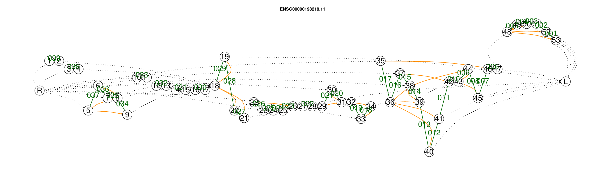
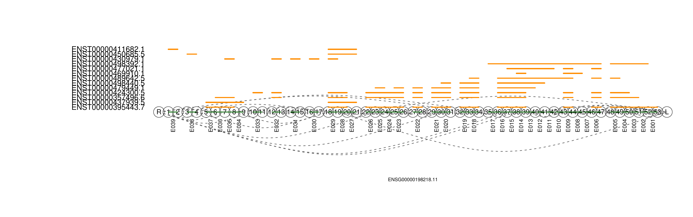
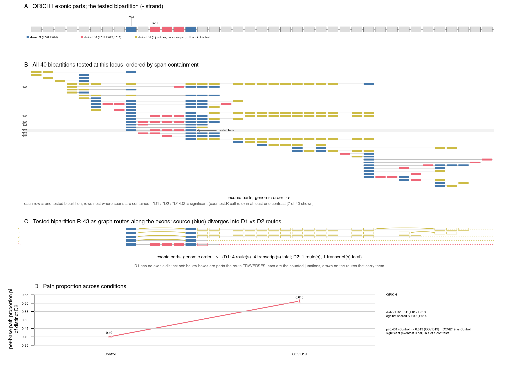
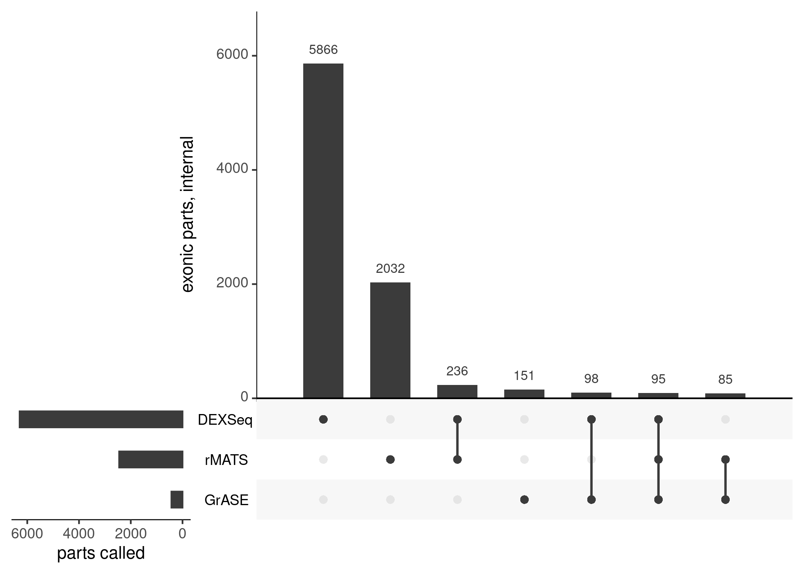

```{r setup, include=FALSE}
knitr::opts_chunk$set(echo = TRUE, eval = FALSE)
```

## Overview

GrASE (**Gr**aph of **A**lternative **S**plice Junctions and **E**xonic Parts) detects
differential alternative splicing between two or more conditions by representing each gene as a
directed acyclic splicing graph. It bridges the gap between splice-junction-based tools
(e.g., rMATS) and exon-fragment-based tools (e.g., DEXSeq) by identifying "bubbles"
(subgraphs between shared source and sink nodes) that correspond to alternative splicing
events, and then testing for differential usage of the exonic parts that distinguish each
path through a bubble.

The complete workflow has six stages, each driven by a command-line Rscript:

| Stage | Script | Purpose |
|-------|--------|---------|
| 0 | `scripts/createfiles.sh` (shell) | Prepare per-gene GTF, DEXSeq GFF, and splicing graphs |
| 1 | `bubble_path_split.R` | Enumerate alternative path groups per bubble |
| 2 | `filterTerminal.R` | Separate internal events from terminal events |
| 3 | `bipartition_junction_sets.R`, `sigcnt.py` | Count the reads on each side and its shared reference, each read once per set |
| 4 | `exontest.R` | Test for differential exon usage and annotate results |
| 5 (optional) | `outward_walk.sh` (shell) | Locate which annotated start or end a terminal call belongs to |

---

## Prerequisites

### R packages

```{r install, eval=FALSE}
# Bioconductor dependencies
if (!requireNamespace("BiocManager", quietly = TRUE))
    install.packages("BiocManager")
BiocManager::install(c(
    "SplicingGraphs", "GenomicFeatures", "txdbmaker",
    "DEXSeq", "rtracklayer", "IRanges", "S4Vectors",
    "AnnotationDbi", "GenomeInfoDb", "MatrixGenerics"
))

# CRAN dependencies
install.packages(c("igraph", "glmmTMB", "VGAM", "gtools",
                   "dplyr", "stringr", "optparse", "parallel"))

# Install grase itself, from a clone of the repository:
#   git clone https://github.com/HanLabUNLV/GrASE.git
#   R CMD INSTALL GrASE/Rpkg
```

### External tools

- Python with `HTSeq`. Both DEXSeq helper scripts are bundled with grase
  (`inst/python/`), so there is nothing to fetch separately.
- Coordinate-sorted RNA-seq BAM files, one per sample, under
  `bam/<condition>/`. Align however you prefer; the published results used
  two-pass STAR, whose drivers are in the GrASE_simulation repository. The
  counts GrASE reads are produced from the BAMs in Step 0b below; STAR's
  `SJ.out.tab` files are needed only for the per-part alternative to Stage 3.

---

## Stage 0. Prepare input files

Before running GrASE you need three kinds of per-gene files (generated by
`scripts/createfiles.sh <workdir> <annotation.gtf>`, or equivalent preprocessing steps):

```
<project>/
|-- ref/
|   `-- genelist               # one Ensembl gene ID per line
|-- gtf/
|   `-- ENSG00000000003.14.gtf # per-gene GTF sliced from the full annotation
|-- dexseq.gff/
|   `-- ENSG00000000003.14.dexseq.gff   # DEXSeq exonic-part GFF per gene
|-- graphml/                   # generated by generate_graphs.R (Step 0c)
|   `-- ENSG00000000003.14.graphml
`-- DEXSeq/                    # dexseq_count_sig.py output (Step 0b): counts and .sig files
    `-- count_files/
        |-- group1/
        |   |-- sample1_counts.txt
        |   `-- sample2_counts.txt
        `-- group2/
            |-- sample3_counts.txt
            `-- sample4_counts.txt
```

Every command below writes `${WD}` for that directory, so set it once:

```bash
WD=/path/to/project
```

For human GENCODE v28 and v34, Steps 0a and 0c can be skipped entirely. The
splicing graphs, bipartitions, per-gene GTFs and DEXSeq GFFs are deposited at
[doi:10.5281/zenodo.23141907](https://doi.org/10.5281/zenodo.23141907). Download
them, then start at Step 0b and count your BAMs against the `dexseq.gff`
deposited alongside the graphs. Counting against a GFF you prepared yourself
will not join: exonic part numbers are assigned per GFF.

grase ships the DEXSeq helper scripts, and an extended counter, so an installed
package already has them:

```r
system.file("python", "dexseq_prepare_annotation.py", package = "grase")
system.file("python", "dexseq_count.py", package = "grase")
system.file("python", "dexseq_count_sig.py", package = "grase")
```

From a shell, resolve them once and reuse:

```bash
DEXSEQ_PREP=$(Rscript -e 'cat(system.file("python","dexseq_prepare_annotation.py",package="grase"))')
DEXSEQ_COUNT=$(Rscript -e 'cat(system.file("python","dexseq_count.py",package="grase"))')
DEXSEQ_COUNT_SIG=$(Rscript -e 'cat(system.file("python","dexseq_count_sig.py",package="grase"))')
```

All need `HTSeq` importable by the interpreter that runs them.

**Step 0a. Split the genome GTF by gene and prepare DEXSeq GFF files**

```bash
outdir=${WD}

# Split a genome GTF into per-gene files
mkdir -p ${outdir}/{ref,gtf,dexseq.gff,graphml}
awk -v outdir="${outdir}/gtf" '{
    if (match($0, /gene_id "[^"]+"/)) {
        id = substr($0, RSTART+9, RLENGTH-10);
        f = outdir "/" id ".gtf";
        print >> f; close(f);
    }
}' ${outdir}/ref/gencode.v28.annotation.gtf

# Build the gene list
ls ${outdir}/gtf | sed 's/\.gtf$//' > ${outdir}/ref/genelist

# Generate DEXSeq GFF files (one per gene, run in parallel)
cat ${outdir}/ref/genelist | \
    parallel -j 30 -I {} \
    "python dexseq_prepare_annotation.py \
        ${outdir}/gtf/{}.gtf \
        ${outdir}/dexseq.gff/{}.dexseq.gff"

# Concatenate them into the single GFF the counter reads in Step 0b.
cat ${outdir}/dexseq.gff/*.dexseq.gff > ${outdir}/ref/gencode.dexseq.bygene.gff
```

Build the aggregate by concatenation, not by running
`dexseq_prepare_annotation.py` on the whole genome GTF. A genome-wide run merges
overlapping genes into `ENSG1+ENSG2` groups and renumbers their exonic parts, so
the counts would no longer join to the per-gene graphs. Concatenating per-gene
output keeps one `aggregate_gene` record per gene and the numbering intact.

**Step 0b. Count reads on exonic parts**

Count each sample with the bundled `dexseq_count_sig.py`, against the aggregated
GFF from Step 0a, one file per sample under `DEXSeq/count_files/<condition>/`. It
is `dexseq_count.py` with one addition: next to the per-part counts, which are
identical to `dexseq_count.py`'s, it writes `<out>.sig`, the read signatures (for
each read or read pair, the exonic parts it overlaps and the introns it crosses)
from which Stage 3 counts each read once per set.

```bash
outdir=${WD}

for cond in group1 group2; do
    mkdir -p ${outdir}/DEXSeq/count_files/${cond}
    for bam in ${outdir}/bam/${cond}/*.bam; do
        s=$(basename "${bam%.bam}")
        python $DEXSEQ_COUNT_SIG \
            --format bam --order pos \
            --paired yes --stranded reverse -a 10 \
            ${outdir}/ref/gencode.dexseq.bygene.gff \
            "$bam" \
            ${outdir}/DEXSeq/count_files/${cond}/${s}_counts.txt
    done
done
```

The flags are not interchangeable, and getting them wrong is silent rather than
noisy:

| Flag | Meaning |
|------|---------|
| `--paired` | `yes` for paired-end, `no` for single-end. A paired setting on single-end reads recovers almost nothing. |
| `--stranded` | `reverse` for dUTP protocols (Illumina TruSeq Stranded), `yes` for forward-stranded, `no` for unstranded. The wrong choice returns roughly the antisense fraction. |
| `--order` | `pos` for coordinate-sorted BAMs, `name` for name-sorted |
| `-a` | MAPQ floor; 10 keeps unique mappers under STAR's convention |

If you are adding samples to an existing analysis, count them under the settings
the existing files used, not the settings you would pick fresh. Recover those
empirically if they were not recorded: re-count a few bins of one sample under
each candidate and compare against the stored file. Only the correct setting
reproduces it bin for bin.

**Step 0c. Build splicing graphs**

This step converts the per-gene GTF and DEXSeq GFF into igraph objects saved as GraphML
files. Genes with only a single transcript are skipped automatically.

```bash
Rscript scripts/generate_graphs.R --indir ${WD}
```

This creates `${WD}/graphml/{gene}.graphml` for every multi-transcript gene.

---

## Stage 1. Enumerate alternative path splits

Each bubble in the splicing graph separates transcript paths into groups.
**Use `bipartition`.** It is the recommended and supported scheme, and the one
every reported result uses: each test is a binary split of the bubble's paths
into two groups with a well-defined distinct set on each side.

```bash
Rscript scripts/bubble_path_split.R \
    --graphdir=${WD}/graphml \
    --outdir=${WD}/bipartition \
    --split=bipartition &> bipartition.log
```

`--split` also accepts `multinomial` and `n_choose_2`. These exist because the
three schemes were benchmarked against each other, not as alternatives to pick
between: bipartition had the fewest null-gene false positives, n_choose_2
roughly tripled them, and multinomial more than quintupled them while covering
the fewest bubbles, because it drops any bubble where even one path lacks a
distinct exonic part. Use them only to reproduce that comparison.

**Key options**

| Option | Description |
|--------|-------------|
| `--graphdir` | Directory containing `{gene}.graphml` files |
| `--outdir` | Directory where split result files are written |
| `--split` | `bipartition` (recommended); `multinomial` and `n_choose_2` are benchmark-only |
| `--genename` | Process a single gene (for debugging) |
| `--collapse` | Collapse nested bubbles before splitting (default: FALSE) |

**Output:** two tab-delimited files per gene, e.g.
`${WD}/bipartition/ENSG00000000003.14.bipartition.txt`.
`<gene>.bipartition.all.txt` lists every bipartition enumerated.
`<gene>.bipartition.txt`, which later stages read, keeps one bipartition per
pair of distinct sets (`setdiff1`, `setdiff2`): the one whose reference parts
are closest to the distinct parts, then the one with the fewest reference parts
(counting `R` and `L` as reference parts), then an internal bipartition over one
that starts at `R` or ends at `L`. A skipped exon is therefore tested between
its flanking exons rather than inside a larger bubble anchored at a terminal
node. The row number of this file is the `event` id used by every later stage.

---

## Stage 2. Filter by event class (internal vs. terminal)

Each graph carries two terminal nodes, named in transcription order rather than genomic
order: the root `R`, where transcription starts, and the leaf `L`, where it ends. (They
are not "left" and "right" on the chromosome -- for a minus-strand gene `R` has the
higher coordinate.) Bubbles that begin at `R` or end at `L` are terminal events: they
correspond to alternative transcription start or end sites rather than internal
alternative splicing. Stage 2 separates each gene's split file into two subsets:

- **internal**  -  bubbles entirely within the gene body
- **terminal**  -  bubbles that touch the start or end of the gene

```bash
Rscript scripts/filterTerminal.R \
    --split_dir="${WD}/bipartition" \
    --outdir="${WD}/bipartition.filtered" \
    --split_type='bipartition'

```

**Output:** per-gene files with `.internal.txt` or `.terminal.txt` suffixes in the filtered
output directory.

---

## Stage 3. Count the reads on each side

Stage 3 counts, for every bipartition, the reads on each side's distinct set and
on its shared reference, each read once per set, from the read signatures of
Step 0b. Summing per-part counts instead would count a read once for every part
of a set it overlaps. A side with no distinct exonic part is counted on its
distinct introns: the introns every route of the side crosses and no route of the
other side does. A read that overlaps exonic parts of two genes on the same
strand is counted for neither.

```bash
# junction sets of every bipartition, from the splicing graphs
for T in internal terminal; do
  Rscript scripts/bipartition_junction_sets.R \
      --inputdir   ${WD}/bipartition.filtered \
      --graphmldir ${WD}/graphml \
      --gff        ${WD}/ref/gencode.dexseq.bygene.gff \
      --type $T --output ${WD}/junctions.$T --cores 16
done

# samples.tsv: signature file, sample, group
for cond in group1 group2; do
  for f in ${WD}/DEXSeq/count_files/${cond}/*_counts.txt.sig; do
    printf "%s\t%s\t%s\n" "$f" "$(basename "$f" _counts.txt.sig)" "$cond"
  done
done > ${WD}/samples.tsv

# signatures bucketed by gene, then each side counted once per read
python3 scripts/sigcnt.py split --samples ${WD}/samples.tsv --outdir ${WD}/sig_buckets
for T in internal terminal; do
  python3 scripts/sigcnt.py count --buckets ${WD}/sig_buckets --samples ${WD}/samples.tsv \
      --bipartdir ${WD}/bipartition.filtered --junctiondir ${WD}/junctions.$T \
      --type $T --outdir ${WD}/bipartition.exsj.$T.counts --cores 16
  python3 scripts/combine_exoncnt.py ${WD}/bipartition.exsj.$T.counts \
      ${WD}/bipartition.exsj.$T.counts/bipartition.exsj.$T.cnt.combined.txt
done
```

**Output** per class: `{gene}.bipartition.exsj.{class}.cnt.txt` (per-sample counts
of the reference and both sides, with the source of each side, `exon` or `sj`, and
its junctions), `{gene}.bipartition.txt` (the event annotation Stage 4 joins on
gene and event), `measured_junctions.txt` (the junctions each junction-measured
side was counted on, from which Stage 4 takes the number of junctions for its
effective length) and the combined table for Stage 4. A gene is written only if
some side has reads. With more than two groups, list every sample with its group
in `samples.tsv`; Stage 4 chooses the comparisons through `--contrasts`.

---

## Stage 3, per-part alternative: aggregate DEXSeq counts onto split exonic parts

The route GrASE used before read signatures, kept for existing count files: the
per-part counts of Step 0b summed over each set, with junction counts from STAR
substituted where a distinct set is empty. A read is counted once for every part
of a set it overlaps. Stage 4 needs `--count_per_part` for these counts, so that
its effective lengths match them.

Stage 3 reads DEXSeq per-sample count files, maps them to the exonic parts belonging to
each alternative path, and produces per-event count tables that Stage 4 can test.

Run separately for each split type and each event category (internal / terminal):

```bash
# bipartition  -  internal AS events
Rscript scripts/exoncnt.R \
    -c ${WD}/DEXSeq/count_files \
    -t bipartition \
    --cond1=group1 --cond2=group2 \
    -a internal \
    -i ${WD}/bipartition.filtered \
    -o ${WD}/bipartition.ex.internal.counts

# bipartition  -  terminal
Rscript scripts/exoncnt.R \
    -c ${WD}/DEXSeq/count_files \
    -t bipartition \
    --cond1=group1 --cond2=group2 \
    -a terminal \
    -i ${WD}/bipartition.filtered \
    -o ${WD}/bipartition.ex.terminal.counts
```

Repeat the two commands above for another split type, if you are reproducing the
benchmark, by
substituting the appropriate `-t`, `-i`, and `-o` values.

**Key options**

| Option | Description |
|--------|-------------|
| `-c` / `--countdir` | Root directory of DEXSeq count files. Must contain `{cond1}/` and `{cond2}/` subdirectories each with `{sample}_counts.txt` files |
| `-t` / `--type` | Split type; use `bipartition` |
| `--cond1`, `--cond2` | Condition labels matching the count subdirectory names |
| `--conditions` | Comma-separated list of all conditions for a multi-group run, e.g. `CD4,CD8,NK,B`. Overrides `--cond1`/`--cond2`. |
| `-a` / `--alt` | Event class: `internal` or `terminal` |
| `-i` / `--input_path` | Directory of filtered split files from Stage 2 |
| `-o` / `--output_path` | Directory for per-gene count output files |

**Output:** per-gene `{gene}.{splittype}.ex.{alt}.cnt.txt` files plus a concatenated
`{splittype}.ex.{alt}.cnt.combined.txt` summary file ready for Stage 4.

---

For more than two groups, give `--conditions` instead of the pair:

```bash
    --conditions=CD4,CD8,NK,B
```

The counts are written once for every condition named, and `exontest.R` then
chooses which comparisons to run through its own `--contrasts`. Counting and
testing are separate steps, so there is no need to recount to add a contrast.

---

### Per-part alternative, continued: junction counts where a distinct set is empty

Some bipartitions have no exonic part exclusive to one side. The path may skip the
bubble entirely, connecting source to sink through an intron, or no single part may
lie on every route of that side. There is nothing to count, so the side is
structurally untestable on exonic coverage alone.

For those sides only, the distinct set becomes the intron edges inside the bubble
that are exclusive to that side, counted from split reads. The shared reference is
never changed. In the published run this applied to 28.5% of tests.

The junction set of a side is the introns that every route of the side crosses,
as the exonic distinct set is the parts every transcript of the side uses. A
route is one path through the side. Every molecule of the side then crosses each
junction of the set once, and the side's count is the sum of their counts. A side
whose routes share no distinct intron is not substituted and is not tested: no
junction count measures all of its molecules.

```bash
# Count split reads on the intronic edges of each bipartition.
# STAR SJ.out.tab files live under --sjdir, one per sample.
Rscript scripts/bipartition_sjcnt.R \
    --inputdir   ${WD}/bipartition.filtered \
    --graphmldir ${WD}/graphml \
    --gff        ${WD}/ref/gencode.dexseq.bygene.gff \
    --sjdir      ${WD}/STAR \
    --cond1 group1 --cond2 group2 \
    --output     ${WD}/sjcnt \
    --type       internal \
    --cores      32

# Fold them into the exonic counts, replacing empty distinct sets only.
Rscript scripts/merge_exon_sj_counts.R \
    --exon_counts ${WD}/bipartition.ex.internal.counts \
    --sj_counts   ${WD}/sjcnt \
    --output      ${WD}/bipartition.exsj.internal.counts
```

`bipartition_sjcnt.R` also takes `--conditions` in place of `--cond1`/`--cond2`,
matching `exoncnt.R`.

Run the counting once per event type: `--type internal` and `--type terminal` write
per-gene files with the same name, so they need separate `--output` directories.

Stage 4 then runs on the merged directory instead of the exonic one. A
junction-sourced side has its `setdiff` left NA in the output, which is how
`exontest.R` recognises it and applies `--min_dpi_sj` rather than `--min_dpi`.
With `--sj_overhang`, such a side gets the effective length of its junctions
(Stage 4).

`merge_exon_sj_counts.R` writes the junctions each substituted side was measured
on to `measured_junctions.txt` in its `--output` directory, one row per
junction-sourced side: `gene`, `event`, `comparison` and `junctions`. It joins
to the test results on `gene`, `event` and `comparison`. Each junction is
`chr:start:end`, and the junctions of one side are joined by `|`; they are the
junctions every route of the side crosses, and their counts are summed, as the
reads on the parts of an exonic distinct set are.

---

## Stage 4. Test for differential exon usage

Stage 4 reads the combined count table and tests each bubble event for differential
exonic-part usage between conditions. It first estimates the overdispersion
parameter phi (if needed), then fits the chosen model per event.

### Statistical models

**Use `betabinom_EBapprox` or `betabinom_EBmap`.** Both are beta-binomial models
with empirical Bayes moderation of the per-test dispersion; they differ only in
how the moderated value is obtained, and they agree closely.

| Model | Description |
|-------|-------------|
| `betabinom_EBapprox` | Closed-form shrinkage of log(phi) toward a global or trend-based target (normal-normal moderation). The package default, and the model behind the published results. |
| `betabinom_EBmap` | MAP estimate of phi under a normal prior, optimised against the penalised likelihood. Recovers slightly more true positives at a few more null false positives. |

The remaining models exist because the four were benchmarked against each other.
They are not alternatives to choose between for an analysis.

| Benchmark-only | Why it is not recommended |
|----------------|---------------------------|
| `betabinom_MLE` | No shrinkage, so the dispersion frequently collapses to the binomial limit and null false positives inflate several-fold. |
| `wilcoxon` | Needs no distributional assumption, but is the most conservative on null genes and gives no direct measure of how the path proportion changed. |
| `dirmult_EBplugin` | Dirichlet-multinomial for `--splittype=multinomial`, which is itself benchmark-only. |

With either EB model the dispersion is shrunk toward a loess trend of
log(phi) on log(baseMean), so the shrinkage target follows the mean-dispersion
trend rather than a single global value. This is on by default
(`--use_phi_loess`); `--no_phi_loess` shrinks toward the global median instead,
the default before 2026-11-18. Only phi is shrunk: the group coefficients, and
so `effect_size`, are the unpenalized fit with that phi held fixed.

### Running the tests

```bash
Rscript scripts/exontest.R \
    --file=bipartition.exsj.internal.cnt.combined.txt \
    --outdir="${WD}/bipartition.internal.test" \
    --countdir="${WD}/bipartition.exsj.internal.counts/" \
    --gff_dir="${WD}/dexseq.gff" \
    --read_length=<read length> --sj_overhang=<aligner minimum overhang> \
    --splittype=bipartition \
    --phi=phi.internal.EBapprox.txt \
    --model=betabinom_EBapprox \
    --cond1='group1' --cond2='group2' \
    &> bipart.internal.betabinom_EBapprox.log
```

With counts from the per-part alternative to Stage 3, add `--count_per_part`.
Swap `--model` and the `--phi` filename to run another model. Give each model its
own `--phi` name: `exontest.R` reuses an existing phi file in `--outdir` rather
than re-estimating, so a shared name silently fits one model's dispersions to
another's.

For more than two groups, replace `--cond1`/`--cond2` with `--contrasts` in
`trt:ref` form:

```bash
    --contrasts='CD4:B,CD8:B,NK:B'
```

### Key options

| Option | Default | Description |
|--------|---------|-------------|
| `--file` | | Combined count table from Stage 3 (relative to `--countdir`) |
| `--outdir` | | Directory for results and the cached phi file |
| `--countdir` | | Per-gene count and split files |
| `--gff_dir` | NULL | Per-gene DEXSeq GFFs, flat `<gene>.dexseq.gff` or nested `<gene>/<gene>.dexseq.gff`. Supplying it adds length-normalized (per-base) pi to the annotated output. |
| `--splittype` | | `bipartition` (recommended); the other two are benchmark-only |
| `--phi` | | Cached phi estimates; created on first run, reused thereafter |
| `--model` | `betabinom_EBapprox` | See the table above |
| `--cond1`, `--cond2` | | Two-group contrast; the coefficient is cond1 - cond2 |
| `--contrasts` | NULL | Multi-group contrasts as `trt:ref`, comma separated; overrides `--cond1`/`--cond2` |
| `--padj_method` | `BH` | Plain Benjamini-Hochberg over all events of a contrast. `nested_BH` instead selects genes by BH on each gene's Simes p-value, then BH-adjusts tests within each selected gene and multiplies them by the number of genes tested over the number selected (Benjamini-Bogomolov). Any other `p.adjust` method is also accepted. |
| `--padj_threshold` | 0.05 | Threshold for the `significant` column, and the gene screen in `nested_BH` |
| `--min_effect` | 0.4 | Minimum \|effect_size\|, the log odds ratio of the fitted model, to call a side |
| `--min_dpi` | 0 | Minimum \|delta_pi\| for an exon-sourced side to be called; 0 is no delta_pi gate |
| `--min_dpi_sj` | 0 | The same for a junction-sourced side, where the distinct set is junction counts |
| `--read_length` | NULL | Read length (mate length if paired), for the effective lengths of per-base pi |
| `--sj_overhang` | NULL | Minimum overhang the aligner required on each side of an annotated junction; gives junction-measured sides an effective length |
| `--count_per_part` | FALSE | Counts are per-part DEXSeq counts summed over a set (the per-part alternative to Stage 3); effective lengths are then summed part by part |
| `--min_reads` | 10 | Mean reads on the distinct set, in at least one group, required to call a side |
| `--delta` | 0 | `lfc_diff_net` must exceed this; the post-hoc filter on reference movement |
| `--use_phi_loess` | TRUE | Loess trend log(phi) ~ log(baseMean) as the shrinkage target instead of the global median; turn off with `--no_phi_loess` |
| `--independent_filtering` | TRUE | DESeq2-style filtering on baseMean before correction, on top of the `--min_reads` floor; `--no_independent_filtering` turns it off. Under `--padj_method nested_BH` the filter runs on the event rows before the nested stages, choosing its cutoff by a plain BH, which is not the procedure applied afterwards |
| `--readjust` | FALSE | With a reused results file, recompute `padj_gene` and `padj` from the stored p-values under the current `--padj_threshold`, `--padj_method` and filtering setting, without refitting |
| `--pseudocount` | | Added to ref reads when ref == 0, for all-or-nothing switches |
| `--mc_cores` | | Cores for the per-event fits |

### The significance call

The `significant` column is TRUE when all of the following hold, which is the rule
every reported result uses:

- `padj < --padj_threshold` (0.05 by default, under plain BH)
- \|delta_pi\| passes `--dpi_gate` (below) at `--min_dpi`, or at `--min_dpi_sj` where the side is junction-sourced; both are 0 by default, so there is no delta_pi gate unless one is set
- \|effect_size\|, the log odds ratio of the fitted model, is at least `--min_effect` (0.4)
- `lfc_diff_net > --delta`, i.e. the distinct set moved more than the shared reference
- at least `--min_reads` on the distinct set, on average, in one group

`delta_pi` is a ratio of raw counts. It is comparable across samples, but not across
partitions or genes whose distinct and shared sets differ in length. With `--gff_dir`
and `--read_length` the output also carries the length-normalized (per-base) columns
`len_D`, `len_S`, `pi_ctrl_perbase`, `pi_trt_perbase` and `delta_pi_perbase`. The lengths
are effective lengths, the number of positions a read can start at and still be counted
on the set. By default the counts are read signatures (`scripts/sigcnt.py`), each read
counted once per set, and each run of adjacent parts counts `L + read_length - 1` bases.
With `--count_per_part` the counts are per-part DEXSeq counts summed over the set, a read
counted once for every part it overlaps, and each part counts `L + read_length - 1`,
summed part by part. A junction-sourced side counts `read_length - 2 * sj_overhang + 1`
per junction with `--sj_overhang`, and is NA without it.

`--dpi_gate` chooses which effect size the `significant` column uses:

| `--dpi_gate` | `significant` requires |
|---|---|
| `both` (default) | raw and per-base \|delta_pi\| both at the cutoff, raw alone where per-base is NA |
| `perbase` | per-base \|delta_pi\| at the cutoff, raw where per-base is NA |
| `raw` | raw \|delta_pi\| at the cutoff |

Per-base rescaling enlarges delta_pi when the distinct set is much shorter than the
reference, and per-base assumes reads are spread evenly along a part, which does not
hold near transcript ends. `both` keeps a side only when neither scale is below the
cutoff. `both` and `perbase` need `--gff_dir`; without it the gate is raw, with a warning. The output also has
`dpi_raw_pass` and `dpi_perbase_pass`, which report each gate at the same per-row
cutoff whatever `--dpi_gate` was, so a call can be read as raw-only, per-base-only
or both. Re-running with a different gate does not refit: when the results already
exist, `exontest.R` reuses them and only redoes the annotation (`--retest` refits).

## Stage 5 (optional). Locate terminal events

A called terminal bipartition says that one side's distinct set changes usage
between conditions. It does not say which annotated start or end of that side
the change belongs to. `outward_walk.sh` asks this for every called terminal
side, using short-read counts only.

The terminus of each route of the side is its first exonic part after `R`, or
its last before `L`. The script tests each terminus, and the unit just outward
of it, in place of the distinct set: against the side's own shared reference,
with the same test as Stage 4. The unit outward is the next exonic part, the
intronic part between the two, or, beyond the gene's outermost part, a 300 bp
flank. When a terminus is called and the unit outward shows no comparable
change, the change stops at that terminus. "No comparable change" means the
outward unit is empty or nearly so; or too thin to test but with read support at
most `--max_flank_cov` (0.2) of the terminus's; or tested and uncalled with a
small effect (|delta_pi| below `--min_dpi`, opposite in sign, or below
`--max_outward_frac` (0.5) of the terminus's). An outward unit that is uncalled
but moves about as much as the terminus, or that is thin without a fall in
coverage, leaves the terminus not judgeable rather than bounded: failing a
cutoff is not evidence of no change. `Inf` for both options reproduces the
verdicts from before these guards were added.

Intronic parts are counted separately from the exonic parts, so the exonic
counts do not change. Count them with the same `dexseq_count.py` flags as the
exonic counts.

```bash
bash scripts/outward_walk.sh \
    --workdir         ${WD}/outward \
    --results         ${WD}/bipartition.terminal.test/test_bipartition.ex.terminal_betabinom_EBapprox.annotated.txt \
    --terminal_counts ${WD}/bipartition.ex.terminal.counts/bipartition.ex.terminal.cnt.combined.txt \
    --split_dir       ${WD}/bipartition.filtered \
    --graphml_dir     ${WD}/graphml \
    --gff_dir         ${WD}/dexseq.gff \
    --exon_counts     ${WD}/DEXSeq/count_files \
    --samples         samples.tsv \
    --contrasts       group2:group1 \
    --read_length     <read length> \
    --dexseq_flags    "--format bam --paired yes --stranded reverse --order pos -a 10" \
    --python          <python with HTSeq>
```

A terminus or outward unit is called with `is_significant()`, the rule that
called the sides: `--padj` (0.05, as exontest.R), raw and per-base `--min_dpi` (0), `--min_effect`
(0.4) and `--min_reads` (10). Set them to the values the terminal results were
called with. Per-base delta_pi uses the unit's own effective length, so
`--read_length` is required; `--dpi_gate raw` or `perbase` gates on one scale only.

Add `--subset_called --samtools <samtools>` to build the intronic parts only for genes
with a called side and to count each BAM reduced to the read pairs that touch them
(both mates kept). The counts match the full run for those genes
and take minutes instead of hours per BAM. Do not use it when the parts of other genes
are needed.

`samples.tsv` has one line per BAM: its path, condition and sample name, where
`<exon_counts>/<condition>/<sample>_counts.txt` is its exonic count file.
`--terminal_counts` is the table the terminal results were tested on; its
directory must also hold the per-gene `<gene>.bipartition.txt` files.

| Step | Script | Output under `--workdir` |
|------|--------|--------------------------|
| 1 | `intronparts.R` | `intronparts/`: intronic parts and gene-edge flanks, with a manifest |
| 2 | `ig_flank_overlap.py` | `intronparts/unmeasurable.tsv`: flanks covered by another gene's parts, which always count 0 |
| 3 | `dexseq_count.py` | `intronparts/counts/`: intronic part counts per sample |
| 4 | `enumerate_outward_units.R` | `outward_units.tsv`: the termini and outward units of each called side |
| 5 | `build_outward_counts.R` | the count table and `outward_side_table.tsv` |
| 6 | `exontest.R` | `test/`: the test of each unit |
| 7 | `score_outward_walk.R` | `outward_walk_verdict.tsv` and `outward_walk_verdict.partitions.tsv` |

`outward_walk_verdict.tsv` has one row per terminus and contrast. The `walk`
column is the result:

| `walk` | Meaning |
|--------|---------|
| `walk_stops` | The terminus is called and nothing just outward of it is |
| `walk_continues` | The terminus is called and so is the unit outward |
| `no_claim` | The terminus is not called, or the unit outward could not be judged |

`term_verdict` says how each `walk_stops` was reached, from strongest to weakest
evidence: `drop: outward tested, uncalled` (the unit outward was tested and not
called), `drop: outward empty` (it has no reads), `drop: outward near-empty` and
`drop: outward untestable` (too few reads to test), and `drop: gene edge`
(nothing lies outward). Only the first two are a measured absence of change,
so report them apart from the rest, and report each contrast separately.

`outward_walk_verdict.partitions.tsv` has one row per called side and contrast, with
the side's own test result (`comparison`, `source`, `sink`, `padj`, `delta_pi`,
`delta_pi_perbase`, the `dpi_*_pass` flags, `d_support`) beside the rollup over its
termini (`n_term`, `n_judgeable`, `n_positive`, `side_verdict`, `best_evidence`). Its `walk`
is `walk_stops` when any of the side's termini is, `walk_continues` when the
side has a judged terminus and none stops, and `no_claim` otherwise. The
side-level result is not adjusted for the number of termini, so quote the
terminus table first.

## Visualising results

Three entry points, for three different questions.

### The splicing graph and the transcript structure

`style_and_plot()` draws the graph for one gene; `plottx()` draws the transcript
blocks above the same coordinates. Both are exported, and both write a PDF into
`outdir` named after the gene (`<gene>.pdf` and `<gene>.tx.pdf`).

```r
library(grase); library(igraph); library(SplicingGraphs)

gene   <- "ENSG00000198218.11"
outdir <- "${WD}/figs"

g <- igraph::read_graph(file.path("${WD}/graphml", paste0(gene, ".graphml")),
                        format = "graphml")
style_and_plot(g, gene, outdir)

gr   <- rtracklayer::import(file.path("${ANNOT}/gtf", paste0(gene, ".gtf")))
gr   <- gr[!(rtracklayer::mcols(gr)$type %in% c("start_codon", "stop_codon"))]
txdb <- txdbmaker::makeTxDbFromGRanges(gr)
sg   <- SplicingGraphs::SplicingGraphs(txdb, min.ntx = 1)
plottx(gene, outdir, as.data.frame(SplicingGraphs::sgedges(sg[gene])),
       SplicingGraphs::sgnodes(sg[gene]), g = g)
```

Both take `node_range = c(n_min, n_max)` to crop to a window of `sg_id` values,
which is how you show one region of a large gene rather than the whole locus.

Run on QRICH1 (ENSG00000198218), `style_and_plot()` gives the splicing graph:

{width=100%}

and `plottx()` the transcript structure above the same node coordinates:

{width=100%}

`scripts/plotgraphml.R` and `scripts/splicegraph_tx_plot.R` do the same thing in
batch over a vector of gene ids edited at the top of the file. They take no
command-line options.

### One bipartition in detail

`scripts/plot_test_results.R` is the figure behind the case studies: the gene
model with each exonic part coloured by its role, every bipartition tested at the
locus ordered by span containment, the path groups, and the path proportion
across conditions.

```bash
Rscript scripts/plot_test_results.R \
    --gene ENSG00000198218 --event 4 --kind terminal --unit exsj \
    --analysis ${WD}/grase_covid_exsj \
    --sjcounts ${WD}/bipartition.exsj.terminal.counts \
    --graphmldir ${WD}/graphml \
    --conditions Control,COVID19 \
    --symbol QRICH1 \
    --out figs/QRICH1_ev4.png
```

| Option | Description |
|--------|-------------|
| `--gene`, `--event`, `--kind` | The bipartition to draw; `--kind` is `internal` or `terminal` |
| `--analysis` | Directory of `exontest.R` results |
| `--graphmldir` | Per-gene splice graphs; exonic part coordinates and strand come from here |
| `--sjcounts` | Merged count directory, needed when a side is junction-sourced |
| `--conditions` | Comma-separated, in the order to plot |
| `--comparison` | `diff1_vs_ref` or `diff2_vs_ref`; by default the called side |
| `--feature_contrast` | Which contrast the caption quotes; by default the called one with the largest \|delta_pi\| |
| `--mark_parts` | Annotate parts, e.g. `E019:exon 4,E024:exon 6` |
| `--max_stack` | Cap on bipartitions drawn in panel B |
| `--raw` | Plot the raw count ratio instead of the length-normalized proportion |
| `--out` | Output path; the extension picks the format, so `.pdf`, `.png` or `.eps` all work |

It applies no thresholds of its own. It reads the `significant` column that
`exontest.R` wrote, so the figure and the tables cannot disagree.

The command above produces:

{width=100%}

Reading it: **A** is the gene model, each exonic part coloured by its role in the
tested bipartition -- blue for the shared reference S, yellow and red for the two
distinct sets. **B** is every bipartition tested at this locus, one row each,
ordered by span containment so nesting reads as intervals inside intervals; the
grey row is the one being shown and a star marks each bipartition called in at
least one contrast, labelled by which distinct set drove it. **C** redraws the
tested bipartition as routes through the graph, with R and L marking a route that
reaches the transcript start or end. **D** plots the path proportion across
conditions, length-normalized by default.


---

## Comparing GrASE results with other tools

GrASE provides scripts to map its results onto rMATS events and onto DEXSeq or
satuRn exonic parts, for direct comparison. They read the annotated output of
Stage 4, so run them after testing. The paths below assume `betabinom_EBapprox`;
substitute the model name you ran.

Every comparison script takes `--pval`, one cutoff applied to each tool's
adjusted p-value: GrASE `padj`, rMATS `FDR`, DEXSeq `padj`, satuRn empirical
FDR. Pass the same value to all of them. Each tool's call also needs an effect size.
GrASE is called by `grase::is_significant()` at `--pval`, so `lfc_diff_net`, the
`|delta_pi|` gates (`--min_dpi`, `--min_dpi_sj`) and `--min_reads` apply; rMATS needs
`|IncLevelDifference| >= --min_dpsi` (0.1) and DEXSeq or satuRn
`|log2 fold change| >= --min_l2fc` (0.5). An rMATS event also needs a mean IJC+SJC of
at least `--rmats_min_reads` (10) and a mean PSI within `--rmats_min_psi` (0.05) of 0
and 1 in both groups; an event that fails is kept with its `FDR` set to 1
(`grase::rmats_gated_fdr()`). A GrASE test counts as tested when it
has a `p.value`; its `padj` is NA when its gene was not selected at the gene
level, which is not a call. The exonic-part tables keep every part either tool
tested, with `*_tested` flags, so a part one tool did not test is not counted
against the other. When the GrASE results hold several contrasts,
`--contrast` names the one to compare.

### Compare with DEXSeq or satuRn

`compare_dexseq_grase.R` compares on exonic parts. Each GrASE bipartition is spread
over the parts of both its distinct sets and is called if either side is; a part in
several bipartitions is called if any of them is, and keeps the test with the
smallest `padj`. `--exon_results` takes a DEXSeq results table or a satuRn table
run on DEXSeq exonic parts (detected by the absence of a `pvalue` column; its
empirical p-values are used).

```bash
Rscript scripts/compare_dexseq_grase.R \
    --grase ${WD}/bipartition.internal.test/test_bipartition.ex.internal_betabinom_EBapprox.annotated.txt,${WD}/bipartition.terminal.test/test_bipartition.ex.terminal_betabinom_EBapprox.annotated.txt \
    --exon_results ${WD}/saturn/saturn_group1_group2/all.group1_group2.sumExp_filteredbyCountMultiExon.txt \
    --pval 0.05 \
    --output ${WD}/bipartition.internal.test/saturn_grase_betabinom_EBapprox_comparison.txt
```

It writes one row per part either tool tested (with `grase_tested` and `exon_tested` flags), a `.discrepancies.txt` list of the
parts only one tool called, and a PDF of the p-value and effect-size agreement.

### Compare with rMATS

`map_rmats_bipartitions.R` matches each rMATS event to the bipartition whose
two sides hold the event's two forms (inclusion and skipping, long and short,
retained and spliced), read from the splicing graph. `--splitdir` with
`--class` names the per-gene bipartition files the tests were run on, so the
matched `bipartID` is the `event` of the test output. rMATS builds an event
from junctions that need not lie on one transcript; an event whose junctions
no bipartition separates is left unmatched (`bipartID` NA).

```bash
# Step 1: map rMATS events to GrASE bipartitions
Rscript scripts/map_rmats_bipartitions.R \
    --graphdir ${WD}/graphml \
    --splitdir ${WD}/bipartition.filtered --class internal \
    --rmatsdir ${WD}/rMATS/rmats_post_group1_group2/ \
    --outdir ${WD}/map_rmats/results.bipartition

# Step 2: compare results
Rscript scripts/compare_rmats_grase.R \
    --grase ${WD}/bipartition.internal.test/test_bipartition.ex.internal_betabinom_EBapprox.annotated.txt \
    --rmats_dir ${WD}/rMATS/rmats_post_group1_group2/ \
    --map_dir ${WD}/map_rmats/results.bipartition/ \
    --pval 0.05 \
    --output ${WD}/bipartition.internal.test/rmats_grase_betabinom_EBapprox_comparison.txt
```

### Compare rMATS against the exon-level tool, through the graph

`compare_rmats_dexseq.R` contrasts rMATS directly with DEXSeq or satuRn, rather than each
against GrASE. This is the capability introduced in the first GrASE paper
(Aquino et al. 2025), carried forward here: neither tool has a unit the other
shares, so the splicing graph supplies the correspondence, mapping each rMATS
event onto the exonic parts it covers.

It never reads GrASE results, so it runs once. Point `--map_dir` at the event's own
exonic parts from `map_rmats_graph.R`, which needs no bipartition and so maps more
events; a `map_rmats_bipartitions.R` mapping also works but covers only the events
matched to a bipartition of one class.

```bash
Rscript scripts/map_rmats_graph.R ${WD}/graphml ${WD}/rMATS/rmats_post_group1_group2/ ${WD}/map_rmats/graph
Rscript scripts/compare_rmats_dexseq.R \
    --map_dir ${WD}/map_rmats/graph \
    --outdir  ${WD}/rmats_vs_exon \
    --rmats_dir ${WD}/rMATS/rmats_post_group1_group2/ \
    --exon_results ${WD}/dexseq/dexseq_results.txt --pval 0.05
```

`--exon_results` takes a DEXSeq results table, or a satuRn table, which is
detected and converted automatically (its combined id is split into
`groupID`/`featureID`, and `empirical_pval`/`empirical_FDR` become
`pvalue`/`padj`).

Output is a cross-tabulation at two levels, written under `--outdir`:

| Directory | Contents |
|-----------|----------|
| `ExonParts/` | exon parts called by one tool, split by what the other did: `DexSig__rMATS_SigExons.txt`, `DexSig__rMATS_TestedExons.txt`, `DexTested__rMATS_DetectedExons.txt` and so on |
| `SplicingEvents/` | the same from the rMATS side, e.g. `rMATS_Sig__DexSigEvents.txt` |
| `Mapped.ExonsToEvents.txt`, `Mapped.EventsToExons.txt` | the joined tables both views are derived from |

The three-way split matters when reading these: *tested* is the tool's universe,
*detected* means the other tool's unit mapped onto it at all, and *significant*
is a call. A part that is DEXSeq-significant but rMATS-tested-and-not-called is a
genuine disagreement; one that is DEXSeq-significant and not rMATS-detected is
outside rMATS's reach, which is a different statement.

### All three tools on exonic parts

`compare_parts_upset.R` translates GrASE, rMATS and DEXSeq calls to exonic parts
and draws UpSet plots of which tools call each part, once over every part called by
any tool (`upset_exonic_parts`) and once over the parts all three tested
(`upset_exonic_parts.tested_by_all`). Each tool keeps its own call rule: GrASE
`grase::is_significant()` at `--pval`, rMATS `FDR` (after the same count/PSI gate) with `|IncLevelDifference| >= --min_dpsi`,
DEXSeq `padj` with `|log2 fold change| >= --min_l2fc`, all at `--pval`. A GrASE
bipartition counts as called when either side is, and contributes the parts of both
distinct sets; a part shared by several bipartitions or events is called if any
of them is. `--grase` takes one results file per class (named by `--class`) and
`--map_dirs` the rMATS mappings to use. The class is a property of GrASE's bipartitions
only, so rMATS and DEXSeq are never split by it: the plots above treat GrASE as one tool,
and with two classes `upset_exonic_parts.by_class` puts GrASE internal and GrASE
terminal side by side against the same rMATS and DEXSeq calls.

rMATS parts come from whichever mapping `--map_dirs` names: the matched
bipartitions (`map_rmats_bipartitions.R`), or the event's own parts from
`map_rmats_graph.R`, which needs no bipartition and so maps more events.

```bash
Rscript scripts/map_rmats_graph.R ${WD}/graphml ${WD}/rMATS/rmats_post_group1_group2/ ${WD}/map_rmats/graph
Rscript scripts/compare_parts_upset.R \
    --grase ${WD}/bipartition.internal.test/test_bipartition.ex.internal_betabinom_EBapprox.annotated.txt \
    --map_dirs ${WD}/map_rmats/graph --class internal \
    --rmats_dir ${WD}/rMATS/rmats_post_group1_group2/ \
    --dexseq ${WD}/dexseq/dexseq_results.txt --pval 0.05 --outdir ${WD}/upset
```

Each row of the plot is a tool and each bar counts the exonic parts called by exactly the
tools marked below it. In the first plot each bar is split by how many of the three tools
tested the part (3, 2 or 1), so a tool's single-tool bar separates parts the others examined
and did not call from parts only that tool could examine. The example is the COVID-19 brain data (GSE188847), internal class,
with rMATS parts from `map_rmats_graph.R`:

{width=80%}

---

## Worked example: COVID-19 brain (GSE188847)

This is the whole pipeline on a public dataset: post-mortem brain RNA-seq, 21
COVID19 and 22 Control samples (GEO GSE188847), paired-end 2x150, dUTP
(`--stranded reverse`). The drivers are in `scripts/GSE188847/`; each is a thin
wrapper around the scripts above and takes its settings from `config.sh`
(`BASE`, `WD`, `ANNOT`, `PY`, `SAMTOOLS`, `CORES`). Output goes to `$WD`
(`GSE188847_bipartition/`, next to the clone). The contrast is `COVID19:Control`.

The example uses the per-part alternative to Stage 3 (exonic-part counts plus STAR junction counts), so its test and volcano drivers pass `--count_per_part`. Two choices differ from a from-scratch run. The annotation is GENCODE v34, used as
deposited (graphs, filtered bipartitions and per-gene GFFs, doi:10.5281/zenodo.23141907,
unpacked in `ANNOT`), so Stages 0 to 2 are not repeated. The reads were aligned to
Ensembl 107 (contigs `1..22,X,Y,MT`) and no realignment is needed: stage 00 only
renames `chrN` to `N` in the GFFs.

| Stage | Driver | What it does | Vignette stage |
|---|---|---|---|
| 00 | `00_prepare_annotation.sh` | link the v34 graphs and filtered bipartitions; rename contigs; build the counter's GFF | 0 to 2 |
| 10 | `10_dexseq_count.sh` | DEXSeq exonic-part counts, one file per sample (`count_files/<group>/`) | 3 |
| 20 | `20_unpack_star_sj.sh` | STAR `SJ.out.tab` per sample into `sj/<group>/` | 3, per-part |
| 30 | `30_exoncnt.sh` | aggregate counts onto the bipartitions, internal and terminal (`exoncnt.R`) | 3, per-part |
| 40 | `40_bipartition_sjcnt.sh` | split-read counts on the intronic edges (`bipartition_sjcnt.R`) | 3, per-part |
| 50 | `50_merge_exon_sj.sh` | junction counts where a distinct set is empty (`merge_exon_sj_counts.R`) | 3, per-part |
| 60 | `60_exontest.sh` | test the merged counts, internal and terminal (`exontest.R`) | 4 |
| 70 | `70_outward_walk.sh` | locate the terminal calls (`outward_walk.sh --subset_called`) | 5 |

Stages 10 and 20 are independent of each other and both need stage 00. Each stage
stops if its output already exists.

### Before running

- **Readable BAMs.** The counter and rMATS read `<GSM>.bam`; STAR's BAMs here were
  gzipped, so `bam_plain/` holds one readable BAM per sample.
- **Strandedness and pairing.** Wrong flags fail silently. `config.sh` sets
  `--paired yes --stranded reverse --order pos -a 10`, matching rMATS `fr-firststrand`;
  confirm with a strandedness check (for example, the fraction of reads on the
  annotated strand) before counting.
- **A python that imports HTSeq**, and for the walk a samtools:
  `PY=/path/to/python SAMTOOLS=/path/to/samtools`.
- **R packages**: `grase`.

### Run

```bash
cd scripts/GSE188847
export PY=/path/to/python-with-HTSeq SAMTOOLS=/path/to/samtools CORES=16

bash 00_prepare_annotation.sh
bash 10_dexseq_count.sh 8           # 8 samples at a time
bash 20_unpack_star_sj.sh
bash 30_exoncnt.sh
bash 40_bipartition_sjcnt.sh
bash 50_merge_exon_sj.sh
bash 60_exontest.sh                 # betabinom_EBmap, --gff_dir, --dpi_gate=both, --padj_threshold=0.05
bash 70_outward_walk.sh             # needs 60; stops if outward_walk/ exists
bash 75_volcano.sh                  # needs 60; comparison/volcano/volcano.{png,pdf}
```

Stage 60 writes `grase_covid_exsj/test_bipartition.exsj.{internal,terminal}_betabinom_EBmap.annotated.txt`.
To change the gate, edit `--dpi_gate` in `60_exontest.sh` and
rerun it: the fits are reused and only the annotation is redone (about 7 minutes). To change `--padj_threshold` or the filtering, rerun it
with `READJUST=1`, which also recomputes `padj` from the stored p-values. Stage 70 reads the terminal calls, so rerun it after
changing them (move `outward_walk/` aside first).

### Compare with rMATS and DEXSeq

With rMATS (`*.MATS.JCEC.txt`, `fromGTF.*.txt`, here in `rmats_v34/`) and DEXSeq
(`dexseq_v34/dexseq_results.txt`) run on the same v34 annotation and counts, stage 80
runs every comparison with one adjusted p cutoff (`PVAL`, default 0.05):

```bash
bash 80_comparison.sh               # cutoff PVAL=0.05; set PVAL=<value> for another
```

Per class it matches rMATS events to the v34 bipartitions (`map.<class>/`) and
compares GrASE with rMATS (`grase_vs_rmats.<class>.txt`) and rMATS with DEXSeq
(`rmats_vs_dexseq.<class>/`). It compares GrASE with DEXSeq on exonic parts
(`grase_vs_dexseq.txt`), maps rMATS events to their own parts (`map.graph/`), and
draws the three-way UpSet plots with rMATS parts from the graph mapping
(`upset.graph/`). `UPSET_BIPARTITION=1 bash 80_comparison.sh` also draws them with
rMATS parts from the matched bipartitions (`upset.bipartition/`).
All output is under `comparison/`.

rMATS and DEXSeq call exon bins or events, GrASE a bipartition, so the comparison is
the graph-mapped one described above; read the *tested* / *detected* / *significant*
split before counting disagreements.

### Look at a call

```bash
Rscript Rpkg/scripts/plot_test_results.R --gene ENSG00000198218 --event 4 --kind terminal \
    --analysis ${WD}/grase_covid_exsj \
    --sjcounts ${WD}/bipartition.exsj.terminal.counts \
    --conditions Control,COVID19 --symbol QRICH1 --out figs/QRICH1_ev4.png
```

To ask which called terminal sides stop at an annotated start, read
`outward_walk/outward_walk_verdict.partitions.tsv` (stage 70), which holds each called side's
test result and its walk verdict in one row.

---

## References

Aquino,J., Witoslawski,D., Park,S., et al. (2025) A novel splicing graph allows a
direct comparison between exon-based and splice junction-based approaches to
alternative splicing detection. *Briefings in Bioinformatics*, 26, bbaf204.
<https://doi.org/10.1093/bib/bbaf204>

Witoslawski,D., Aquino,J., He,C. and Han,M.V. (2025) Shared and distinct exonic parts
in alternative paths of splicing bubbles. *arXiv*, 2511.05992.
<https://arxiv.org/abs/2511.05992>

---

## Session info

```{r session}
sessionInfo()
```
